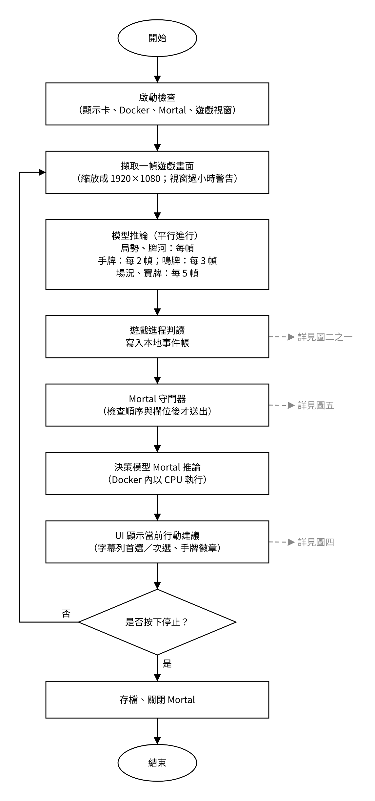
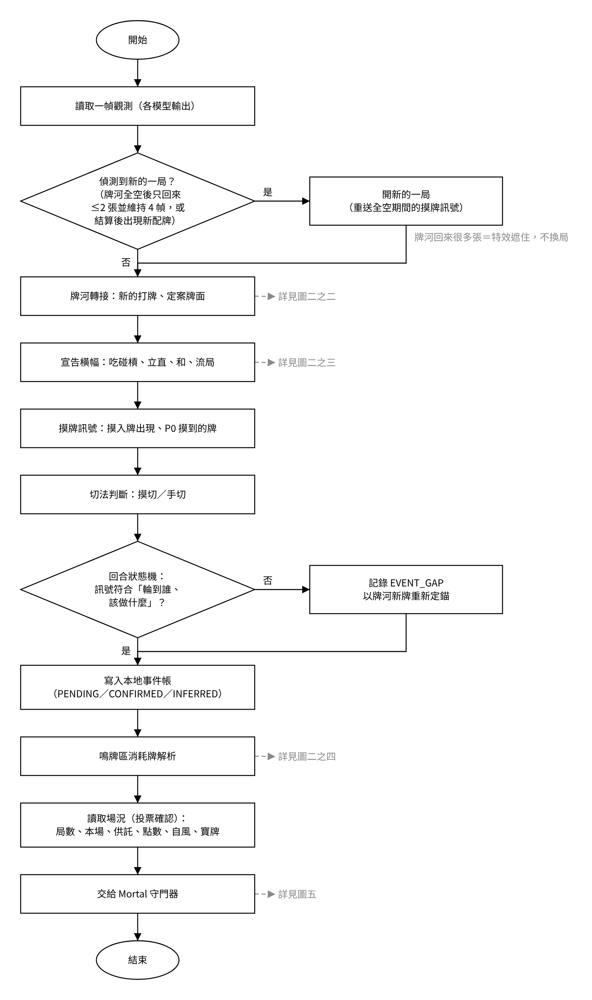
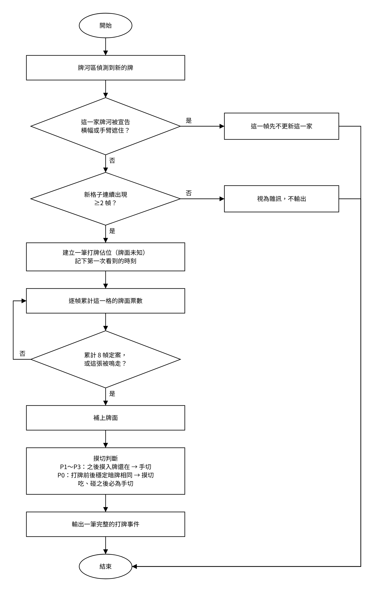
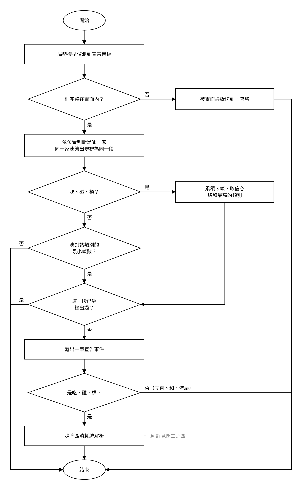
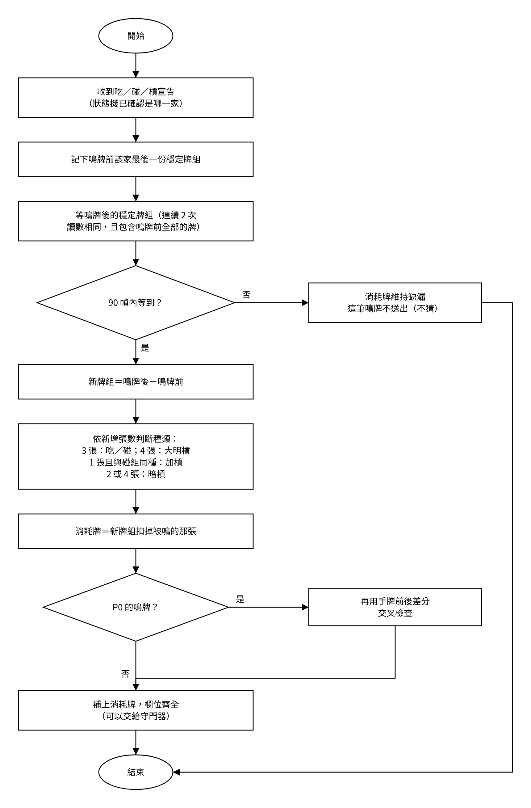
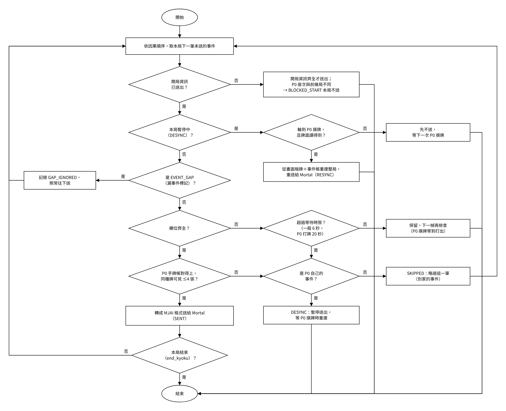
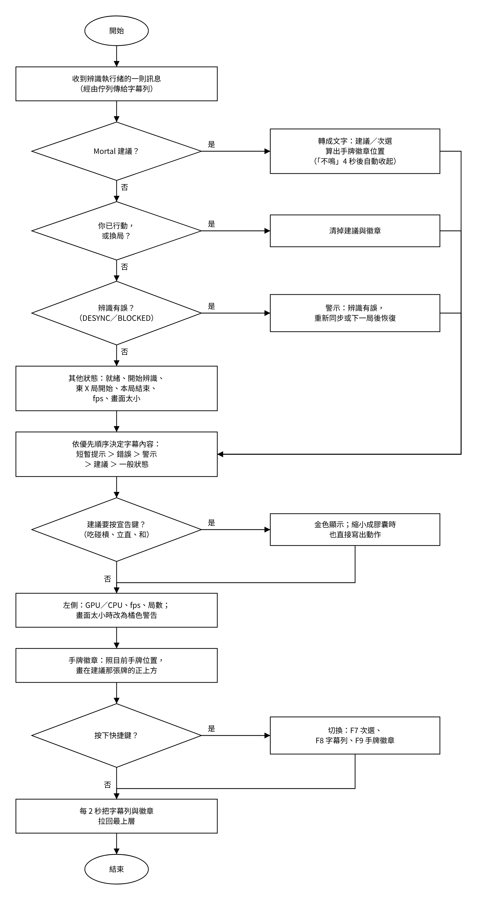

# 程式說明

這份文件說明系統的架構、每一個處理步驟、主要模組與資料格式，給要維護或修改程式的人看。

- [1. 系統架構](#1-系統架構)
- [2. 執行緒與行程](#2-執行緒與行程)
- [3. 辨識模型](#3-辨識模型)
- [4. 逐幀判讀](#4-逐幀判讀)
- [5. 本地事件帳](#5-本地事件帳)
- [6. Mortal 守門器](#6-mortal-守門器)
- [7. Mortal 與建議](#7-mortal-與建議)
- [8. UI：字幕列與手牌徽章](#8-ui字幕列與手牌徽章)
- [9. 啟動器（雀魂AI助手.exe）](#9-啟動器雀魂ai助手exe)
- [10. 模組對照表](#10-模組對照表)
- [11. 紀錄檔格式](#11-紀錄檔格式)
- [12. 除錯工具](#12-除錯工具)
- [13. 設計原則](#13-設計原則)

---

## 1. 系統架構



整個系統是一條單向的管線：

```
遊戲畫面 ─▶ 擷取（1920×1080） ─▶ 4 顆 YOLO 模型 ─▶ 逐幀判讀 ─▶ 本地事件帳
        ─▶ Mortal 守門器 ─▶ MJAI 串流 ─▶ Mortal（Docker） ─▶ 字幕列／手牌徽章
```

- **擷取**只讀畫面像素，不碰遊戲的記憶體或網路封包。
- **本地事件帳**可以補欄位、可以更正；**送給 Mortal 的 MJAI 串流**送出去就收不回來。
  守門器是兩者之間的閘門：只有確定正確的事件才送出。
- 座位一律用相對位置：**P0 = 自己**、P1 = 下家、P2 = 對家、P3 = 上家。
  送給 Mortal 時才換成 MJAI 的絕對座位（東一局時的東家 = 0，整場固定）。

## 2. 執行緒與行程

| 單位 | 做什麼 | 程式 |
|---|---|---|
| 啟動器行程 | 安裝精靈、選平台、擷取確認；用環境裡的 Python 啟動主程式 | `launcher/launcher.py` |
| 主程式：UI 執行緒 | tkinter 字幕列、手牌徽章、全域快捷鍵 | `app/live_v7/agent.py` |
| 主程式：辨識執行緒 | 擷取 → 模型推論 → 判讀 → 事件帳 → 守門器 | `record_obs.py`、`pipeline.py`、`mortal_guard.py` |
| Mortal 行程 | `docker run -i mortal`，stdin 收 MJAI 事件、stdout 回建議 | `app/Mortal/` |

辨識執行緒與 UI 執行緒之間只透過 `queue` 傳訊息（`status`、`advice`、`clear_advice`、`alert`、`kyoku`…），UI 不直接讀辨識狀態。

## 3. 辨識模型

所有模型都用 [ultralytics](https://github.com/ultralytics/ultralytics) 8.4.127 訓練與推論（版本鎖定）。

| 模型 | 檔案 | 架構 | 輸入 | 類別 | 頻率 | valid mAP50-95 |
|---|---|---|---|---|---|---|
| 局勢 | `region_model_best.pt` | YOLO26s | 整張畫面 640 | 11 類：摸入牌、手臂、手牌區、鳴牌區、吃／碰／槓／立直／榮和／自摸／流局橫幅 | 每幀 | 0.866 |
| 牌河 | `river_model_best.pt` | YOLO26s | 四家牌河區 640 | 37 類牌面（含赤五） | 每幀 | 0.907 |
| 手牌 | `hand_model_best.pt` | YOLOv8n | P0 手牌區 640 | 37 類牌面；也用來讀寶牌指示牌 | 每 2 幀 | 0.963 |
| 鳴牌 | `meld_model_v32_1280.pt` | YOLO26n | 四家鳴牌區 1280 | 37 類牌面 | 每 3 幀 | 0.944 |

- 場況（局數、本場、供託、點數、自風）用 `app/assets/` 的模板比對，每 5 幀讀一次並投票確認。
- `*.infer.json` 是推論設定（`{"end2end": false}` = 用 YOLO26 的 one2many 輸出頭），不要刪。
- 牌河、手牌、鳴牌三顆模型的資料集，都是從同一份全畫面標註檔依區域切割出來的。

## 4. 逐幀判讀



每一幀依序處理：

1. **換局判斷**：牌河全空後只回來 ≤2 張並維持 4 幀，或結算後出現新配牌 → 開新的一局。
   牌河一次回來很多張代表是特效遮住後恢復，不換局。
2. **牌河轉接**（`river_adapter.py`，圖二之二）：新的打牌先建立「牌面未知」的佔位，記下第一次看到的時刻；之後逐幀投票，累計 8 幀定案。
3. **宣告橫幅**（`declare.py`，圖二之三）：吃碰槓累積 3 幀取信心總和最高的類別；立直、和了、流局依各自的最小幀數。
4. **摸牌訊號與切法**（`turn_signals.py`）：摸入牌出現、P0 摸到的牌面、摸切／手切。
5. **回合狀態機**（`fsm.py`）：檢查訊號是否符合「輪到誰、該做什麼」；不符合就記 `EVENT_GAP`，並以牌河新牌重新定錨。
6. **鳴牌消耗牌**（`meld_reader.py`，圖二之四）：比對鳴牌前後的穩定牌組，算出吃碰槓用掉哪幾張。
7. **場況**（`kyoku_info.py`）：局數、本場、供託、點數、自風、寶牌，投票確認後補進開局資訊。

<details>
<summary>圖二之二 牌河打牌與摸切判斷</summary>


</details>

<details>
<summary>圖二之三 宣告事件偵測</summary>


</details>

<details>
<summary>圖二之四 鳴牌消耗牌解析</summary>


</details>

### 摸切／手切

- **P1～P3**：判斷點之後幾幀，摸入牌還在原位 → 手切；摸入牌消失 → 摸切。
- **P0**：比對打牌前後的穩定暗牌；暗牌相同 → 摸切。
- 吃、碰之後的打牌必為手切。

## 5. 本地事件帳

`ledger.py` 管理 `events.ndjson`。每個事件有狀態：

| 狀態 | 意思 |
|---|---|
| `PENDING` | 已經知道發生了，但欄位還沒齊（例如打牌的牌面還在投票） |
| `CONFIRMED` | 欄位齊全、由畫面直接確認 |
| `INFERRED` | 畫面上沒有直接看到，由規則推定（例如莊家開局的第 14 張、別家的摸牌、立直成立） |
| `CANCELLED` | 後來證實是誤判 |

事件帳可以補欄位、可以更正，每一次改動都保留在 `history` 裡，方便事後追查。

## 6. Mortal 守門器



`mortal_guard.py` 依因果順序，從事件帳取出下一筆未送的事件，逐項檢查後才轉成 MJAI 送出：

| 送出狀態 | 什麼時候 | 結果 |
|---|---|---|
| `SENT` | 欄位齊全、P0 手牌帳對得上、同種牌可見 ≤4 張 | 送給 Mortal |
| `SKIPPED` | 別家的事件欄位等太久還不齊，或和 P0 手牌帳衝突 | 略過這一筆，建議照常 |
| `GAP_IGNORED` | 狀態機標記的漏事件 | 記錄後照常往下送 |
| `DESYNC` | P0 自己的事件對不上 | 暫停送出，等下一次 P0 摸牌 |
| `RESYNC` | DESYNC 後輪到 P0 摸牌、牌面讀得到 | 從畫面暗牌＋事件帳重建整局，重送給 Mortal |
| `BLOCKED_START` | P0 座次與前幾局不同 | 這一局不送 |

等待時限：一般事件 6 秒、P0 打牌 20 秒；P0 摸牌會等到打出為止。
每一筆的處理結果都寫在 `delivery.ndjson`。

## 7. Mortal 與建議

- Mortal 跑在 Docker 映像 `mortal` 裡（`app/Mortal/Dockerfile`），權重 `app/Model/mortal.pth` 掛載進容器，以 CPU 推論。
- 主程式以 `docker run -i` 啟動，用 stdin／stdout 逐行交換 MJAI JSON。
- **立直的預先詢問**：Mortal 建議立直時，守門器會先送一個假的立直宣告，問「立直的話打哪張」，再撤回；字幕顯示「立直，打 X」。
- Mortal 程序掛掉時，字幕顯示「Mortal 停了」，下一局開始時自動重開。
- `mortal_view.py` 把回覆轉成中文（例如「建議：碰 5p（用 5p 5p）　次選：不鳴」），並算出手牌徽章要標哪幾張。

## 8. UI：字幕列與手牌徽章



- 字幕依優先順序決定內容：短暫提示 ＞ 錯誤 ＞ 警示 ＞ 建議 ＞ 一般狀態。
- 要按宣告鍵的建議（吃碰槓、立直、和）用金色；縮小成膠囊時也直接寫出動作。
- 手牌徽章是無邊框、滑鼠穿透的小視窗，依當下手牌偵測的位置畫在牌的正上方。
- 每 2 秒把字幕列與徽章拉回最上層，避免被遊戲視窗蓋住。
- 快捷鍵用 Windows `RegisterHotKey`，遊戲視窗在前面時也收得到。

## 9. 啟動器（雀魂AI助手.exe）

`launcher/launcher.py` 只用 Python 標準函式庫（tkinter、subprocess、urllib），所以在「什麼都還沒裝」的電腦上也能打開。
需要 cv2／pywin32 的事情（列視窗、擷取預覽）交給 `app/launcher_helper.py`，用環境裡的 Python 執行。

| 頁面 | 內容 |
|---|---|
| SetupPage | 系統檢查、Python 環境（uv 安裝到 `runtime\`）、Docker、Mortal 權重、建立映像 |
| IntroPage | 用途、運作方式、風險、權限、免責聲明（同意後記在 `config.json`） |
| PlatformPage | Steam／桌面版或網頁版；網頁版選 Chrome 或其他瀏覽器 |
| CapturePage | 擷取同意與畫面預覽；網頁版＋Chrome 時先套用 Chrome 設定（`chrome_mode.py`） |
| RunningPage | 執行中；結束後顯示結果、還原 Chrome 設定 |

`打包主程式.bat` 用 PyInstaller 打包成單一 exe；沒有 Python 時先下載 uv 與獨立的 Python 3.10。

## 10. 模組對照表

**`app/`（辨識的基礎模組）**

| 檔案 | 內容 |
|---|---|
| `capture.py` | 找雀魂視窗、擷取用戶端畫面、統一縮放成 1920×1080；網頁版從瀏覽器畫面切出遊戲區 |
| `region_model.py` | 局勢模型推論包裝 |
| `river_model.py` | 牌河模型推論包裝 |
| `hand_model.py` | 手牌模型推論包裝 |
| `meld_model.py` | 鳴牌模型推論包裝（座位裁切 v3.2） |
| `river.py` | 四家牌河的座標、排列方向、打牌順序 |
| `river_track.py` | 牌河的跨幀追蹤與定案 |
| `hand.py` | P0 手牌區的版面常數與工具 |
| `meld.py` | 鳴牌區的固定裁切範圍與工具 |
| `drawn.py` | 摸入牌的座標表與摸切／手切判斷 |
| `event_zones.py` | 依宣告圖示出現的位置判斷是哪一家 |
| `dora_reader.py` | 寶牌指示區的讀取 |
| `tiles.py` | 牌面偵測的純工具 |
| `chrome_mode.py` | 網頁版＋Chrome 的設定套用與還原 |
| `launcher_helper.py` | 啟動器的小幫手（列視窗、擷取預覽） |
| `1_capture.py` | 擷取功能的測試與基準量測（開發用） |

**`app/live_v7/`（即時管線）**

| 檔案 | 內容 |
|---|---|
| `agent.py` | 主程式進入點：字幕列、手牌徽章、快捷鍵、辨識執行緒 |
| `record_obs.py` | 擷取＋模型推論，寫 `observations.ndjson`；畫面太小警告 |
| `obs.py` | 逐幀觀測的格式定義 |
| `pipeline.py` | 一幀觀測 → 轉接層 → 狀態機 → 事件帳 |
| `river_adapter.py` | 牌河轉接層（打牌佔位、定案） |
| `declare.py` | 宣告橫幅 → 宣告事件 |
| `turn_signals.py` | 摸牌訊號與切法判斷 |
| `drawn_lib.py` | P0 摸入牌的第二意見（用本場手牌模型的高信心牌當樣板） |
| `fsm.py` | 回合狀態機 |
| `meld_reader.py` | 吃碰槓的消耗牌與槓型 |
| `kyoku_info.py` | 開局資訊（場況、寶牌） |
| `ledger.py` | 本地事件帳 |
| `mortal_guard.py` | Mortal 守門器與 Mortal 程序管理 |
| `mortal_view.py` | Mortal 回覆 → 中文建議與徽章位置 |
| `mjai_preview.py` | 事件帳的 MJAI 預覽（除錯用） |
| `ui/panel.py`、`ui/scores.py`、`ui/winds.py` | 局數／本場／供託、點數、自風的辨識 |

## 11. 紀錄檔格式

| 檔案 | 格式 | 一筆是什麼 |
|---|---|---|
| `observations.ndjson` | NDJSON | 一幀：各模型的原始偵測框、場況讀值、時間戳 |
| `events.ndjson` | NDJSON | 一個事件的最終狀態：`event_id`、`type`、`actor`、`pai`、`status`、`frame_first`、`history`… |
| `events_live.ndjson` | NDJSON | 事件剛建立時的快照（即時寫入，程式中斷也留得下來） |
| `mjai.jsonl` | JSONL | 一行一筆送給 Mortal 的 MJAI 事件 |
| `mortal_replies.jsonl` | JSONL | `after`（第幾筆事件之後）、觸發事件、Mortal 回覆、時間 |
| `advice.ndjson` | NDJSON | 字幕列顯示過的建議文字與時間 |
| `delivery.ndjson` | NDJSON | 每一筆事件的送出狀態（`SENT`／`SKIPPED`／`DESYNC`…）與原因 |
| `frames.mp4` | MPEG-4 | 錄影（約 6–10 fps） |
| `video_index.csv` | CSV | 錄影幀號 ↔ 觀測幀號 ↔ 時間 |

## 12. 除錯工具

用 `runtime\env.json` 裡記錄的 `python.exe` 執行（或已啟用的 conda 環境），在專案資料夾下：

| 指令 | 用途 |
|---|---|
| `python tools\replay.py 紀錄\<資料夾>\observations.ndjson` | 用紀錄離線重跑判讀，印出每一局有沒有被擋下、為什麼 |
| `python tools\check_sheet.py 紀錄\<資料夾>\events.ndjson` | 印出每一家每一張打牌、摸切／手切，方便跟牌譜對照 |
| `python tools\dump_frames.py 紀錄\<資料夾> 600-700:5` | 從錄影抽出指定幀存成圖片 |
| `python tools\dump_dora.py 紀錄\<資料夾>` | 檢查寶牌指示牌的讀法 |
| `python tools\reread_region.py 紀錄\<資料夾> --river <權重> --tag <名稱>` | 用錄影換一個模型重新辨識（比較新舊模型） |
| `python tools\reread_ui.py 紀錄\<資料夾>` | 用錄影重算場況 |
| `python tools\test_overflow.py 紀錄\<資料夾>` | 測試牌河超過 18 張時讀不讀得到 |

## 13. 設計原則

- **寧可不送，不要送錯**：送給 Mortal 的事件收不回來。欄位不齊就等，等太久就略過（別家）或暫停（自己），不猜。
- **錯了要能自己恢復**：P0 對不上時不整局停送，而是等下一次 P0 摸牌時從畫面重建。
- **定案過的不重算**：牌河的格子一旦定案就不再改，避免後面的動畫把前面讀對的牌改錯。
- **版本鎖定**：ultralytics、torch 版本固定；不同版本對同一個模型的推論結果不同。
- **全部留紀錄**：每一幀的原始輸出、每一個事件的修改歷史、每一筆送出狀態都存下來，事後可以重播與對照牌譜。
